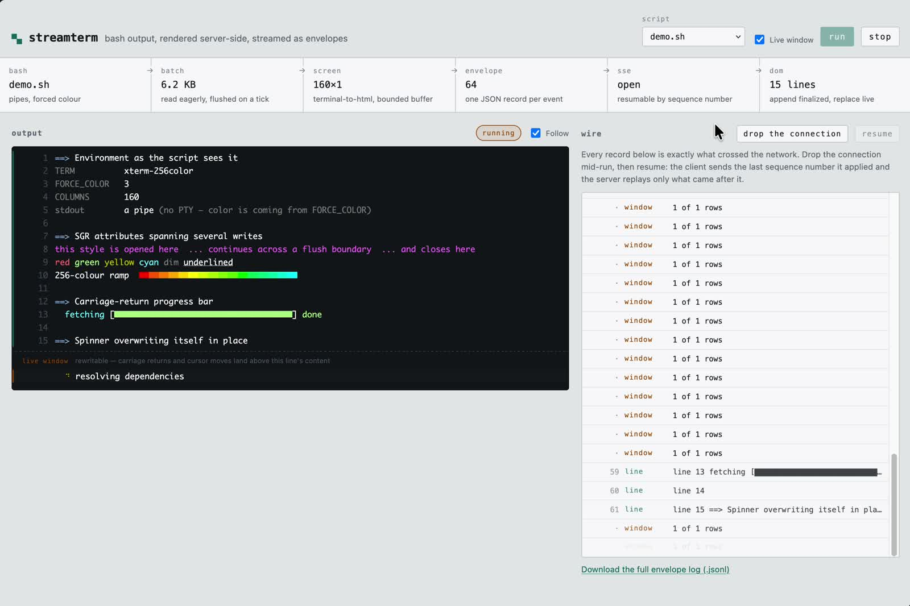

# streamterm

A proof of concept for streaming server-side terminal output to a browser,
inspired by CI/CD log viewers such as GitHub Actions.

This test project explores how a script running on a server can deliver live,
coloured output to a read-only frontend, handle progress updates, and resume
after a dropped connection. It is a small experiment in the mechanics behind
build logs, rather than a complete CI/CD system.

## Demo

[](docs/demo.mp4)

[Watch the video](docs/demo.mp4) to see server-side script output stream into
the browser, with numbered finalized lines, a rewritable live window, and the
underlying event stream alongside it.

## How it works

A bash script runs on the server. Its output is rendered to HTML server-side by
[`terminal-to-html`](https://github.com/buildkite/terminal-to-html), packaged as
JSON envelopes, and streamed to the page over Server-Sent Events. The stream is
resumable: drop the connection mid-run and reconnect, and the server replays
only what you missed.

```
bash                     pipes, not a PTY; colour forced via environment
  │
  ├─ stdout ─┐
  ├─ stderr ─┴─ one file descriptor      ordering settled by the kernel
  │
  ▼
batcher                  read eagerly, flush on a 60 ms tick or 16 KB
  │
  ▼
terminal-to-html Screen  bounded to one window of scrollback
  │
  ├──▶ finalized lines   scrolled off the screen; immutable, numbered
  └──▶ live window       still on screen; rewritable, sent as row patches
  │
  ▼
JSON envelopes           one record per event, monotonic sequence numbers
  │
  ▼
SSE                      resumable by Last-Event-ID
  │
  ▼
DOM                      append finalized, patch live
```

## Running it

Requires Go 1.22+, bash and curl.

```sh
make run          # fetches terminal.css, then serves on 127.0.0.1:8080
make build        # single binary at bin/streamterm (web assets embedded)
make test         # unit tests
```

An end-to-end check runs against a live server:

```sh
make run &
python3 tools/e2e.py
```

It disconnects mid-run, reconnects from its cursor, and asserts that the
finalized lines are contiguous with no duplicates, that the progress bar's
forty rewrites produced exactly one record in its final state, and that
`log.jsonl` matches what the stream delivered.

Then open <http://127.0.0.1:8080>, pick a script and press **Run**.

Useful flags:

```sh
./bin/streamterm -addr :8080 -scripts ./scripts -cols 160 -rows 24 \
                 -flush 60ms -max-mb 32
```

`-rows` is worth playing with. It sets the emulated screen height, which is
also the depth of the mutable region — how far behind the newest output a line
sits before it is committed. Set it to `4` and you can watch lines finalize
almost immediately; set it to `200` and the live window swallows most of the
run.

### Turning the live window off

The **Live window** checkbox, or `{"live": false}` on `POST /api/runs`, runs a
script with no mutable region at all. The screen becomes one row tall, so every
line is committed the moment the next one begins, and no `window` envelope is
ever published. The seam disappears and the whole log is numbered to the last
line.

That is the model a CI log viewer gives you, and it is worth comparing against
directly. GitHub Actions, GitLab and Buildkite all present an append-only,
line-oriented log: each line is stored once, gets a permalink, and is never
revised. They render SGR colour, and they understand line-prefix markers for
folding (`::group::`, `section_start:`), but there is no cursor addressing — no
alternate screen, no moving back up to repaint a line that was already sent.

Note what does *not* change with the live window off: a `\r` progress bar still
collapses to **one** line in its final state, because a one-row screen resolves
the rewrite before committing it. The rewritable region is what disappears, not
the emulator. That distinction is the point of the toggle — turning it off
gives you a CI-style log of the same run, and the finalized lines are identical
either way. `tools/e2e.py` asserts that.

## The two ideas worth stealing

### 1. Split the output into an immutable part and a mutable part

A terminal is not a document. A process can go back and rewrite what it already
printed — a `\r` progress bar rewrites one row forty times a second, and cursor
movement can repaint anything still on screen. So output cannot simply be
appended to a log as it arrives.

But a bounded screen gives you a clean dividing line. Once a line scrolls off
the top, nothing the process writes afterwards can address it. It is final.

`terminal-to-html`'s `Screen` keeps at most `maxLines` of scrollback and calls
`ScrollOutFunc` with the HTML of each line as it is pushed out. Setting
`maxLines` equal to the window height makes "left the buffer" and "left the
screen" the same event, so the callback becomes an exact stream of finalized
lines:

```go
s, _ := terminal.NewScreen(terminal.WithMaxSize(cols, rows))
s.SetSize(cols, rows)
s.ScrollOutFunc = func(html string) { /* this line is now immutable */ }
```

Everything above the boundary is append-only and numbered — safe to permalink,
safe to write to object storage, safe to never touch again. Everything below is
replaced wholesale on each update. `web/app.js` is, as a result, a nine-line
reducer.

The UI marks the boundary with a left rule — teal for the finalized region,
amber for the live one — and by numbering only the finalized side. An earlier
version put a labelled divider bar between the two; it was removed because it
read as an overlay dropped on top of the terminal rather than as part of it.
The distinction is worth showing, but quietly.

### 2. Put the cursor in the client and make the transport disposable

Every durable envelope carries a monotonic sequence number, which becomes the
SSE event id. The browser remembers the last id it applied and replays it in
`Last-Event-ID` on reconnect, so resume costs no application code at all:

```
id: 412
data: {"seq":412,"t":8021,"kind":"line","line":88,"html":"..."}
```

Two consequences follow.

Slow consumers stop being a problem. `hub.publish` writes to buffered
subscriber channels and *drops* any subscriber whose buffer is full, rather
than blocking the producer. One stalled reader can't hold up the pipeline,
because disconnection is recoverable by design — the client reconnects from its
cursor and catches up.

Finished runs stop needing the streaming path. `GET /api/runs/{id}/log.jsonl`
returns the identical envelopes as a flat file. In production that file goes to
object storage when the run ends and is served from a CDN, and the live-log
service never hears about that run again. The test suite asserts that the log
and the stream agree exactly.

Window events deliberately carry **no** id. A window is state, not an
increment; letting one advance the client's cursor would allow a reconnect to
skip finalized lines published after it.

## Envelope format

```jsonc
// `live` is false when the run has no mutable region; no window follows one
{"seq":1,  "t":0,    "kind":"meta",   "script":"demo.sh", "cols":160, "rows":24, "live":true}
{"seq":2,  "t":0,    "kind":"status", "state":"running"}

// a finalized line — append, never revise
{"seq":63, "t":4562, "kind":"line", "line":1, "html":"<span class=\"term-fg34\">==&gt;</span> ...", "bytes":7780}

// the live viewport — sparse patch by row index, `len` gives the height
{"seq":14, "t":1263, "kind":"window", "patch":[{"i":12,"html":"... 30%"}], "len":13}

{"seq":88, "t":9004, "kind":"notice", "text":"Output limit of 32 MB reached..."}
{"seq":89, "t":9010, "kind":"status", "state":"failed", "exit":3}
```

The window started out as a full snapshot per flush. Measuring a run showed the
progress bar putting 24 rows on the wire to convey one row of change, so it
became a row-indexed diff — now a mean of **2.7 rows per window event**, and
exactly **1** during the progress bar. The hub keeps a materialised copy of the
viewport so a client joining late still gets every row in a single envelope.

## Capture-side choices

**Pipes, not a PTY.** A PTY makes `isatty()` true, which buys colour but also
buys full-screen cursor addressing, alternate screen buffers and terminal
queries the process expects answers to. Forced-colour environment variables get
the colour without the rest, and keep the byte stream close to linear — which
is what makes the finalized-line model sound in the first place. The cost:
a tool that ignores `FORCE_COLOR` and only checks `isatty()` emits plain text
here. Swapping in `creack/pty` changes nothing downstream, because everything
downstream already handles arbitrary escape sequences.

```
TERM=xterm-256color   FORCE_COLOR=3   CLICOLOR_FORCE=1   CI=true
PYTHONUNBUFFERED=1    COLUMNS=<cols>  LINES=<rows>
```

`NO_COLOR` is never forwarded — its mere presence, at any value, disables
colour everywhere. The parent environment isn't inherited either; a build agent
runs untrusted-ish code and shouldn't get the server's variables.

**One file descriptor for both streams.** Assigning the same `*os.File` to
`cmd.Stdout` and `cmd.Stderr` makes `os/exec` hand the child a single fd, so
interleaving is resolved by the kernel at write time rather than by a race
between two reader goroutines. Warnings stay next to the lines they belong to.
The tradeoff is that stdout and stderr become indistinguishable; if you need to
tag them, use two pipes with a per-chunk framing header (what Docker's attach
API does) and accept that ordering between them becomes approximate.

**Read eagerly, flush on a tick.** Two separate concerns. Draining the pipe
keeps the child from blocking on write; batching keeps a chatty producer from
becoming one network frame per `printf`. The demo script's 400-line burst
arrives in a couple of chunks.

## Layout

```
cmd/streamterm/main.go       flags, wiring
assets.go                    go:embed of web/ (must live at the module root)
internal/run/runner.go       spawn, environment, batching, byte cap, kill
internal/run/render.go       Screen wrapper: finalized lines + window diff
internal/run/hub.go          envelopes, sequence numbers, replay, fan-out
internal/run/manager.go      orchestration, script allowlist
internal/httpapi/server.go   routes, SSE, JSONL log
web/                         client (no build step, no framework)
scripts/                     runnable demo scripts
tools/fetch-assets.sh        vendors terminal.css at the pinned version
tools/e2e.py                 end-to-end check against a running server
```

### Endpoints

| | |
|---|---|
| `GET /api/scripts` | list runnable scripts |
| `POST /api/runs` | `{"script":"demo.sh"}` → `{"id":"..."}`; add `"live":false` for an append-only run |
| `GET /api/runs/{id}/events` | SSE; `Last-Event-ID` or `?from=` to resume |
| `GET /api/runs/{id}/log.jsonl` | full durable envelope log |
| `POST /api/runs/{id}/stop` | SIGTERM the process group, SIGKILL after 3 s |

## Demo scripts

`demo.sh` is a rendering test as much as a demo: styles opened in one write and
closed in another, a 256-colour ramp, a `\r` progress bar, a self-overwriting
spinner, interleaved stderr, a steady section, and a 400-line burst. It runs
for about twenty seconds.

It is paced deliberately. An earlier version finished in five, which made the
model hard to see: the interesting sections either rewrote a single row or
arrived faster than the eye could follow, so the live window filled and emptied
in one frame. The **steady section** exists for this — a line lands every 0.3 s,
and once the window is full each new line pushes the oldest across the seam, so
you can watch a line stop being rewritable and receive a permanent number. The
burst immediately after is still instantaneous, because that one is about
batching.

`failing.sh` exits non-zero. `quiet.sh` sits silent for 20 seconds, which
exercises the SSE heartbeat that stops idle proxies reaping the connection.

## Things this deliberately does not do

**No virtualisation.** `web/app.js` caps the DOM at 4,000 finalized lines and
drops the oldest. Real CI logs reach hundreds of megabytes and the DOM gives out
long before the data does; a production viewer needs a windowing list
(TanStack Virtual, `react-window`). Trimming is the honest small-scale version —
it keeps the page responsive and makes the ceiling explicit.

**No collapsible sections.** GitHub's `::group::`, GitLab's
`section_start:<ts>:<name>\r\033[0K` and Buildkite's `---` are all line-prefix
markers. Adding them means splitting the incoming bytes on `\n` yourself before
they reach the Screen, tracking the open group, and attaching it as envelope
metadata.

**No output sanitisation.** `terminal-to-html` escapes the process bytes it
renders, but its README is explicit that it is not hardened against XSS. Here
the input is a script you control on disk. If any of it could come from an
untrusted third party, run the HTML through a sanitiser before it reaches the
envelope.

**No auth, no persistence.** Runs live in memory, last 20 retained. The one
security property that *is* enforced: a client can only name one of the
server's own scripts, resolved against a fixed directory and rejected if it
escapes. The HTTP layer never gets to name a path or a command.

**Read-only is a server property, not a UI one.** There is no inbound message
handler on the stream, because SSE has no inbound channel at all. That is most
of why SSE was the right transport here rather than a WebSocket.

## Notes

`terminal-to-html` v3.17+ requires Go 1.25, so **v3.16.0** is pinned in
`go.mod` to build on Go 1.22. Raise both together on a newer toolchain, and
re-run `make assets` — the CSS class names (`term-fgx196`, `term-bgi4`, …) are
an output contract of the library, so the stylesheet and the module have to
move as a pair.
